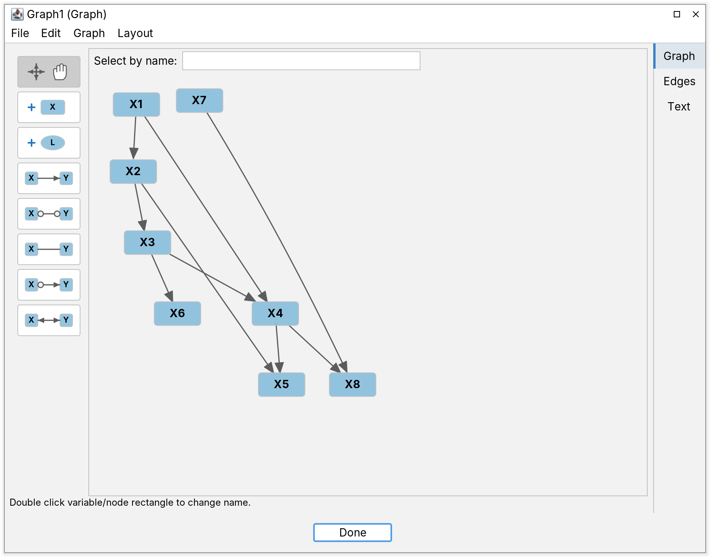
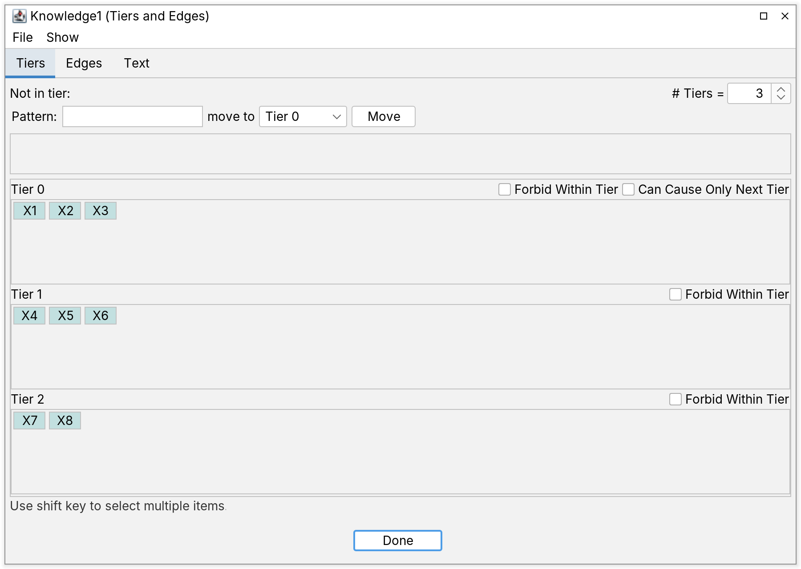

# Graph Editor

The graph editor is where you **create, inspect, and modify** causal graphs (DAGs, CPDAGs, PAGs, etc.) within Tetrad.
Most search results and many tools ultimately produce graph nodes that you can open here.

## Opening and creating graphs

You can obtain a graph in several ways:

- **From a search algorithm** – most search boxes output one or more graphs that appear as nodes in the project tree.
- **By importing** from a file (for example, a Tetrad graph `.txt` file).
- **By creating a blank graph**, using a menu item such as **Graph → New Graph** or an equivalent toolbar button.

To edit a graph, **double-click** its node in the project tree. The graph opens in a new tab in the work area.

## Basic editing operations

In the graph editor, you can:

- **Add variables (nodes)**  
  Use the appropriate toolbar button or right-click on empty space in the editor and choose an “Add node” option.
- **Rename variables**  
  Double-click the node label or use the node’s context menu to change its name.
- **Add edges**  
  Depending on the current edge tool/mode, click on a source node and then on a target node, or drag from one node to another.
- **Delete edges or nodes**  
  Select the edge or node and press Delete/Backspace, or use the context menu.

You can select multiple nodes and edges (for example, by dragging a selection rectangle) to move or delete them together.

### Edge types

The exact **edge types** available depend on the graph type:

- **Directed:** `X --> Y` (e.g., DAG or CPDAG edges).
- **Undirected:** `X --- Y` (e.g., some adjacency graphs or selection-bias edges in PAGs).
- **Partially oriented:** marks like `X o-> Y` in PAGs.
- **Bidirected:** `X <-> Y` in PAGs, often indicating latent confounding.

The editor shows these marks directly on the graph. Some edge types are not allowed for certain graph types; in those cases, the editor will restrict what you can draw or automatically adjust markings to keep the graph legal.

## Layout and visualization

Graphs are arranged by the **Layout** menu. You can always drag nodes by hand afterwards, and
zoom, re-center and fit the graph to the window from the editor's own controls.

### The default: Richard's Layout

A graph that arrives without positions — from a search, from a file, from a regression — is laid
out by **Richard's Layout**, which is why Tetrad's graphs flow down and to the right, with the
exogenous variables at the upper left. It is worth knowing roughly what it does, because the
arrangement carries information.

It is deterministic: the same graph in the same node order gives the same picture every time. It
works in four steps.

1. **Layering by causal depth.** Each node goes in the first layer where everything with an arrow
   into it is already placed, using the directed structure only. For a PAG this means an edge
   `x o-> y` puts `y` below `x`, which matches the reading that `y` is not an ancestor of `x`. If
   the directed structure has a cycle, one edge per cycle is set aside for the layering, so those
   edges — and only those — are drawn pointing up. Everything downstream of a cycle is still
   layered by depth.
2. **Crossing reduction.** Alternating sweeps reorder each layer by the mean position of its
   neighbours, then adjacent nodes are exchanged wherever that reduces the crossing count, until no
   exchange helps. All edge types vote, including edges that span more than one layer, and the best
   ordering seen over all sweeps is kept.
3. **Coordinate assignment.** Nodes are packed by their actual box widths and then pulled toward
   the mean horizontal position of their neighbours, so children line up under their parents.
4. **Shear.** Each layer is shifted right in proportion to its depth, which produces the
   down-and-right flow.

### Choosing a different layout

The menu also offers **Circle**, **Square**, **Fruchterman-Reingold**, **Kamada-Kawai** and
**Causal Order**.

These six entries behave differently from an ordinary command, and it is worth being clear about
it: choosing one **both lays out the current graph and makes that layout the default for graphs
that arrive without one**. They are a single-choice group, so the one currently ticked is the
default in force. If you want to try a layout on one graph without changing what happens
everywhere else, use **Undo Layout Change** afterwards, or set the default back.

**Undo Layout Change** and **Redo Layout Change** step through layout changes specifically, which
is what you want after an experiment you did not like.

### Layouts that use other information

- **Layout by Knowledge** arranges the graph by the tiers in your background knowledge. It appears
  only when knowledge is available to the editor.
- **Layout by Knowledge Indices** uses the knowledge ordering rather than the tiers.
- **Distance From Selected** arranges nodes by graph distance from the node you have selected,
  which is a quick way to read the neighbourhood of one variable in a large graph.
- For a **time-lag model** the menu additionally offers **Top to bottom**, **Left to right**,
  **Bottom to top**, **Right to left** and **Copy lag 0**, which lays out the lagged slices to
  match the contemporaneous one. These appear only for time-lag graphs.

### Keeping layouts consistent across boxes

Comparing two graphs is much easier when the same variable sits in the same place in both. Two
features support that.

**Copy Layout** and **Paste Layout** move an arrangement from one graph to another by variable
name.

**Inherit Layout From** ties this graph's layout to another box's, and keeps it tied. The rule is
worth understanding, because it is designed not to throw away your own adjustments: a node you have
moved since the last synchronization — dragged, laid out, pasted, or put back by an undo — keeps
its own position, and every other node the reference also has takes the reference's position. A
graph with no record yet takes the whole layout of its reference. A node the reference does not
have, or has not positioned, keeps where it is. **Reset to Inherited Layout** discards the local
changes and takes the reference's layout wholesale.

### Curved edges

Edges are drawn as curves, routed around intervening nodes, which is why moving one node can
change the shape of edges that are not attached to it. Above 600 edges the routing is switched off
and every edge is drawn straight, since at that density the curves cost more in render time than
they repay in legibility.

## Background knowledge and tiers

Many algorithms allow **background knowledge** that constrains which graphs are considered during search. This is typically set up through a **Knowledge** box, but it uses a graph view very similar to the graph editor (as shown in the second screenshot).

In the background-knowledge view, you can:

- Mark **forbidden edges** (edges that must not appear in the search result).
- Mark **required edges** (edges that must be present in the result).
- Assign variables to **tiers**, so that variables in one tier cannot have parents from later tiers.

These constraints are saved with the knowledge object and used by algorithms that support knowledge. The underlying graph editor behavior (adding/removing nodes and edges, moving nodes, etc.) is the same as for ordinary graphs, but the marks you make are interpreted as **constraints** rather than as a final learned graph.

## Saving and exporting graphs

Graph nodes can be:

- **Stored in the current Tetrad session**, so you can close and reopen the session with graphs intact.
- **Exported** to simple text or image formats (for example, a Tetrad graph `.txt` file or a PNG image) for use in papers or external tools.

Use the graph’s context menu or the relevant **File/Graph** menu items (such as *Export Graph* or *Save As*) to write out graphs or images. This is especially useful when you need a clean, final version of a graph for a publication or for use in another application.