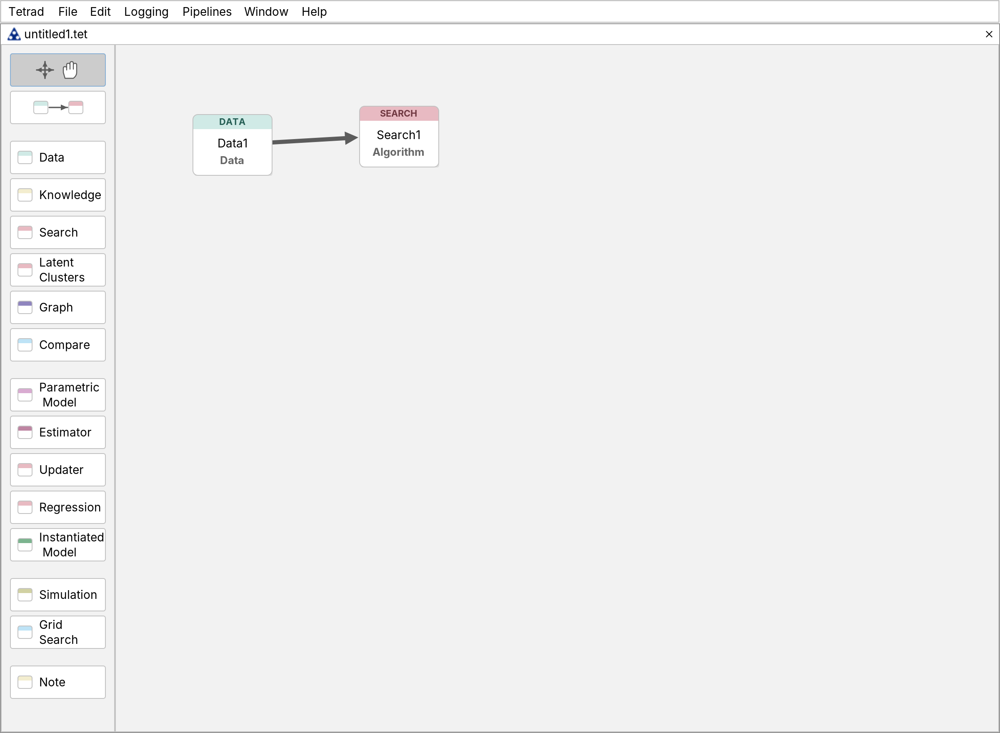

# Main Window

The Tetrad main window has three parts:

- A **menu bar** across the top, for sessions, settings, logging and ready-made pipelines.
- A **desktop** below it, holding one window per open **session**.
- An optional **logging pane** along the bottom, shown while logging is on.

Each session window has two parts of its own: a **box palette** down the left side and a
**workbench** filling the rest. All work in Tetrad is done by placing **boxes** on the workbench,
connecting them with arrows, and double-clicking them.

In a typical session you will:

1. Place boxes on the workbench and connect them (for example, Data → Search).
2. Double-click each box to fill it in: load the data, pick and run the algorithm, and so on.
3. Inspect each result inside the box that produced it.
4. Save the session for later.

## Sessions

A **session** is one workbench together with everything on it: the boxes, the arrows between
them, and the contents of every box — data, graphs, models and results. A session is saved and
loaded as a single file from the **File** menu.

Several sessions can be open at once, each in its own window on the desktop. The **Window** menu
lists the open sessions so you can bring one to the front.

## The box palette

The palette on the left of every session window is a column of buttons. The top two are tools;
the rest each add one kind of box. They appear in this order, in groups separated by a small gap.

**Tools**

1. **Select and Move** — select boxes, or groups of boxes, and drag them around the workbench.
   This is the resting tool; the palette returns to it after most actions.
2. **Draw Edge** — draw an arrow from one box to another, declaring that the first box's contents
   are an input to the second.

**Working with data: load, constrain, search, look**

3. [**Data**](../box-by-box/data-box.md) — load, view, transform and audit data.
4. [**Knowledge**](../box-by-box/knowledge-box.md) — background knowledge: tiers, and required and
   forbidden edges.
5. [**Search**](../box-by-box/search-box.md) — run a search algorithm.
6. [**Latent Clusters**](../box-by-box/latent-clusters-box.md) — cluster measured variables by
   their latent causes. To search over the clusters, make this box a parent of a Search box.
7. [**Graph**](../box-by-box/graph-box.md) — draw, edit and analyze a graph.
8. [**Compare**](../box-by-box/compare-box.md) — compare graphs or models, and check a graph
   against data.

**Modeling and inference on a graph**

9. [**Parametric Model**](../box-by-box/parametric-model-box.md) — choose a model family for a
   graph.
10. [**Estimator**](../box-by-box/estimator-box.md) — fit a parametric model to data.
11. [**Updater**](../box-by-box/updater-box.md) — update a fitted model on evidence or
    interventions.
12. [**Regression**](../box-by-box/regression-box.md) — run a regression.
13. [**Instantiated Model**](../box-by-box/instantiated-model-box.md) — a model with specific
    parameter values.

**Simulation and benchmarking**

14. [**Simulation**](../box-by-box/simulation-box.md) — generate data from a model.
15. **Grid Search** — compare algorithms and settings, on
    [your own data](../box-by-box/grid-search-box-data.md) or on
    [simulated data](../box-by-box/grid-search-box-simulation.md).

**Annotation**

16. [**Note**](../box-by-box/note-box.md) — a text note on the workbench.

The [Box by Box](../box-by-box/index.md) section documents the boxes in this same order.

Earlier versions had a **Latent Structure** button between Latent Clusters and Graph. It was
removed in October 2026; see [Latent Structure Box (removed)](../box-by-box/latent-structure-box.md).

## The workbench

**Placing a box.** Click a box button in the palette, then click the workbench where the box
should go. The palette then returns to Select and Move. To place several boxes of the same kind,
hold **Shift** while clicking; the box button stays selected until you release it.

**Connecting boxes.** Click **Draw Edge**, then drag from one box to another. The arrow means
that the first box feeds the second: Data → Search gives the search its data, and Knowledge →
Search gives it background knowledge. Draw Edge stays selected so you can draw several arrows in
a row; click Select and Move when you are done.

**Opening a box.** Double-click a box. The first time, Tetrad asks whatever it needs in order to
create the box's contents, such as which kind of model or which algorithm. After that,
double-clicking opens the box's editor in its own window. A result lives inside the box that
produced it: the graph from a search is in the Search box, and a fitted model is in the
Estimator box.

**The right-click menu.** Right-clicking a box offers:

- **Create Contents**, **Edit Contents** and **Destroy Contents** — make, open or discard what
  the box holds. Destroying the contents keeps the box and its arrows.
- **Propagate changes downstream** — fill in this box and every box downstream of it,
  overwriting any contents those boxes already have.
- **Rename Box**, **Clone Box** and **Delete Box**.
- **Edit Parameters...** — edit the box's parameters.
- **Help** — a short description of the box.

## Menus

The **menu bar** has seven menus: **Tetrad**, **File**, **Edit**, **Logging**, **Pipelines**,
**Window** and **Help**.

- **Tetrad**  
  The application menu, first in the bar. It holds **About Tetrad**, **Warranty**, **License** and
  **Contributors**, then **Settings...**, then **Quit Tetrad**. On macOS the system's own
  application menu is wired to the same About and Settings items, so either route works.
- **File**  
  Session handling: **New Session**, **Load Session**, **Close Session**, **Save Session**,
  **Save Session As**, and **Save Session Workspace Image...**, which writes a picture of the
  workbench.
- **Edit**  
  Basic editing commands for the workbench.
- **Logging**  
  **Start Logging** opens a logging pane at the bottom of the main window and begins routing log
  messages from algorithms and tools to it. If logging to a file has been configured on the
  **Logging** tab of the Settings dialog, this also starts a new log file on disk. **Stop
  Logging** hides the pane and closes the file.
- **Pipelines**  
  Pre-wired workbench pipelines, in two labelled groups. Under **Analyze a real dataset**: *Load
  data and search*; *Load data, add knowledge, then search*; *Load data, search, then run a Markov
  check*; *Search then estimate*; *Search, estimate, then update*; and *Latent Clustering and
  Structure Search*. Under **Simulation studies**: *Simulate from a given graph, then search*; and
  *Simulate, search, then compare*. Choosing an entry places a connected set of boxes on the
  workbench, which you then fill in by double-clicking each one.
- **Window**  
  Window-management actions.
- **Help**  
  **Website**, **Manual** (which opens this site), **Algorithm Flowchart**, and **Suggestion
  Box!**, which opens Tetrad's issue tracker so you can send a suggestion or report a problem.

## Settings

**Tetrad → Settings...** opens a dialog with three tabs:

- **General** — **Dark Mode**, **Show experimental algorithms everywhere** (which is what reveals
  the methods marked experimental; see [Experimental Methods](../../experimental-methods.md)), and
  **UI font size**.
- **Numbers** — the numeric formatting used throughout the application.
- **Logging** — where log output is written: only to the logging pane, or also to a log file.

In earlier versions these settings were a **File → Settings** submenu. That submenu is gone; use
the Tetrad menu.

## Logging pane

When you choose **Logging → Start Logging**, a **logging pane** opens along the bottom of the main
window, below the desktop, and shows log output from algorithms and tools as they run. Choosing
**Logging → Stop Logging** hides the pane and, if file logging is enabled, closes the current log
file.

For a long-running algorithm, the logging pane is the place to watch progress and warnings.
