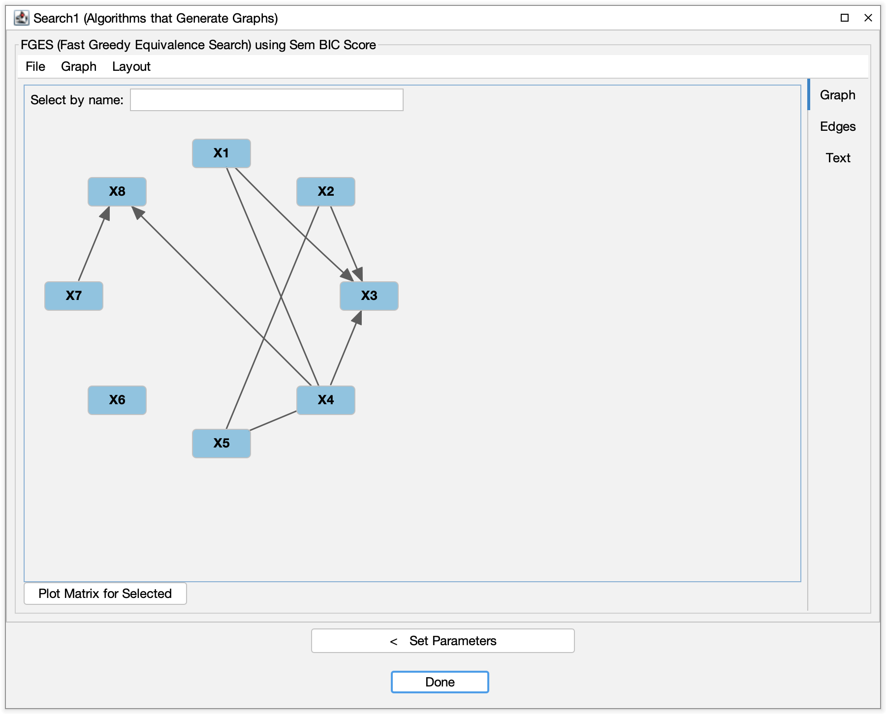
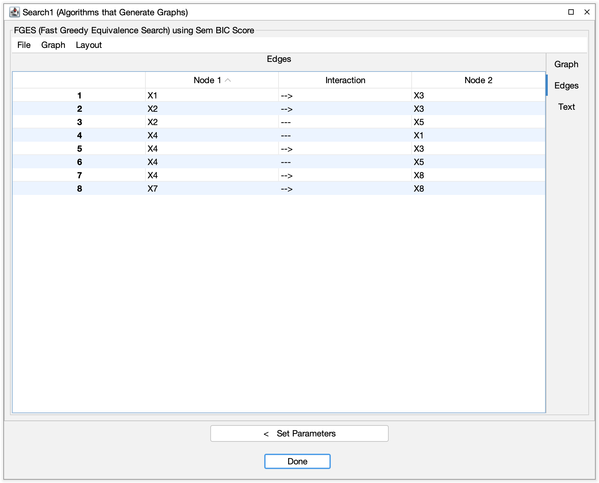

# Viewing and Exporting Results

After you run algorithms or tools, each **result** — a graph, a table, a summary, or diagnostic
information — is held in the box that produced it. This page summarizes how to inspect and export those results.

To see a result again, double-click the box that produced it (for example, the **Search** box or
the **Compare** box). It opens in its own window.

## Graph results

Many algorithms output one or more graphs:

- A **main search graph** (DAG, CPDAG, PAG, MAG, etc.).
- Auxiliary graphs such as **adjacency graphs**, **skeletons**, or graphs highlighting latent structure
  or selection bias (depending on the algorithm).

To inspect a graph:

1. **Double-click** the box holding the graph to open it.
2. Use the editor to:
    - Examine **edge orientations** and endpoint types.
    - Toggle between different **layouts** and zoom levels.
    - Compare multiple graphs by opening their boxes side by side, or by connecting them to a **Compare** box.

For more information on editing and interpreting graphs, see the **Graph Editor** and **Graph Box** pages.

## Tabular and numeric results

Some tools (for example, CStaR, adjustment-set finders, IDA variants, grid search, and stability procedures)
produce **tables** or numerical summaries:

- Each row may correspond to:
    - An edge or variable pair.
    - An adjustment set or separating set.
    - A parameter configuration in a grid search.
- Columns may include:
    - p-values, scores, stability frequencies, or bounds.
    - Effect size estimates and confidence or credible intervals.
    - Information about adjustment sets, separating sets, or path properties.

When you open a box that holds a table:

- The table is shown in the box's window.
- You can usually:
    - **Sort** by clicking on column headers.
    - **Resize** columns and scroll to view additional information.
    - Copy small portions of the table for quick reference.

For more complex filtering or plotting, export the table and work in R, Python, or a spreadsheet program.

## Exporting graphs and tables

Tetrad lets you export results for use in other tools or for inclusion in papers and reports.

### Exporting graphs

From an open graph window, you can:

- **Export to image** (for example, PNG) to include in slides, papers, or documentation.
- **Export to a text-based graph format** (such as a Tetrad `.txt` graph file) to reload later or share
  with collaborators.

Look for options in:

- The **File** menu of the graph's window.

### Exporting tables

From an open table view, you can:

- **Export to CSV or TSV** so you can:
    - Analyze results further in R or Python.
    - Make your own plots and summary tables.
    - Keep a record of settings and outcomes for simulation studies.

Export options are typically available via the **File** menu of the window showing the table.

## Reusing results in pipelines

Results from one step are often intended as inputs to another:

- Use a **learned graph** as input to:
    - **Adjustment-set algorithms**,
    - **IDA** and related effect estimation methods,
- Use **simulated or resampled data** as input to additional search algorithms or model-fitting procedures.
- Use **graphs from grid search or stability analyses** as starting points for more focused analyses.

The workbench encourages an **incremental workflow**:

1. Load data and run a search.
2. Inspect and export the resulting graph or table if needed.
3. Use those results as inputs to new boxes (Compare, Updater, Regression, etc.).
4. Save the entire session to preserve data, graphs, configurations, and results together.